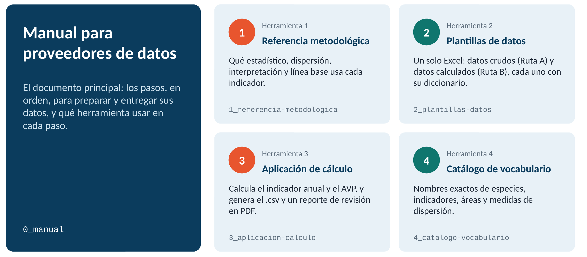
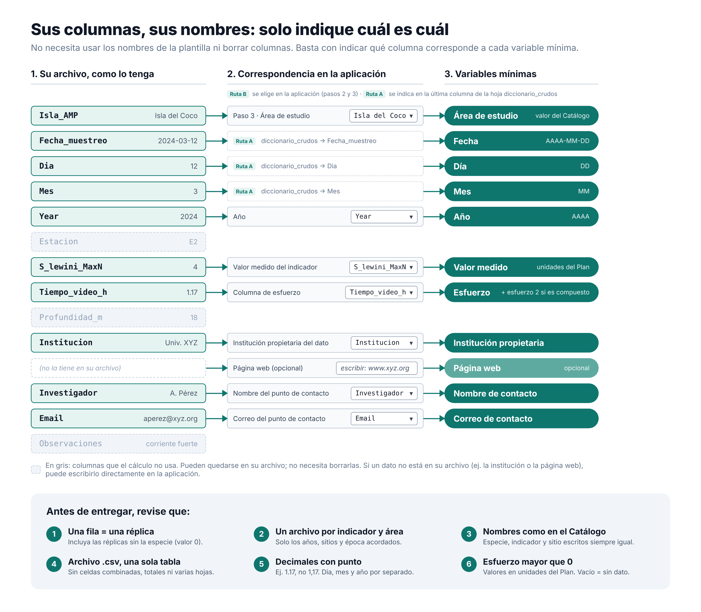
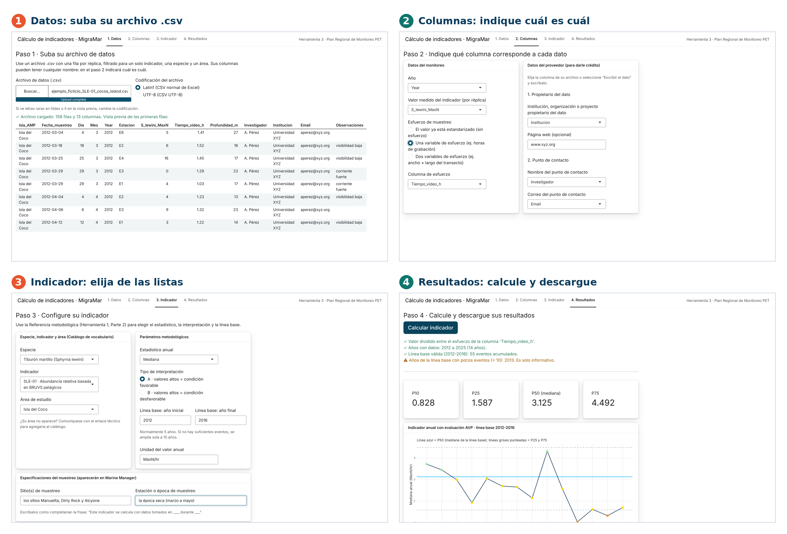

# Manual para proveedores de datos {#sec-manual}

*Pasos operativos · Versión del 27 de octubre de 2026*

Este manual resume, en pasos concretos, lo que debe hacer para entregarnos sus datos. Para el detalle completo de la metodología, consulte el Plan Regional de Monitoreo.

::: callout-important
## Tenga a mano la Referencia metodológica

Mientras este manual indica los pasos a seguir, la [Referencia metodológica](referencia.qmd) (Herramienta 1) aporta el detalle metodológico específico de su indicador.
:::

## Etapa 1 · Antes de empezar

**1.** Ubique la carpeta que MigraMar le compartió para entregar sus datos (su carpeta de recepción).

**2.** Decida su ruta:

-   **Ruta A: usted entrega datos crudos** (tal como los recolectó en campo, ya depurados y cumpliendo los requisitos del punto 4) y MigraMar calcula el indicador.
-   **Ruta B: usted calcula su propio indicador**, con la aplicación de cálculo que le facilita MigraMar o con su propio método, y entrega el resultado ya calculado.

|  | Ruta A · datos crudos | Ruta B · datos calculados |
|----|----|----|
| **Archivo que entrega** | Datos crudos con columnas mínimas y filtradas para cada indicador (ver punto 4) | Datos en formato de la Plantilla de datos calculados |
| **Diccionario de columnas** | Sí, debe incluirlo (ver ejemplo en la Plantilla de datos) | No es necesario |
| **Debe usar la aplicación de cálculo (Herramienta 3)** | No | Sí |
| **Quién calcula el indicador** | MigraMar, pero se generará un reporte que debe verificar antes de publicar en Marine Manager | Usted |
| **Qué herramientas requiero revisar** | Herramientas 1, 2 y 4 | Herramientas 1, 2, 3 y 4 |

**3.** Descargue de la [Caja de herramientas](herramientas.qmd) lo que le corresponda (@fig-kit):

-   **Herramienta 1: Referencia metodológica.** Le dice qué especificaciones aplican a su indicador; la necesitará para completar sus datos y, si le corresponde, para configurar la aplicación de cálculo para su indicador específico.
-   **Herramienta 2: Plantillas de datos.** Un solo Excel con las hojas diccionario_crudos, datos_crudos, diccionario_calculados y datos_calculados; útil para ambas rutas.
-   **Herramienta 3: Aplicación de cálculo.** Solo Ruta B. Si le interesa revisar la programación, puede [leer el código en R](descargas/codigo-R_calculo-indicadores-sinGAMM.html){target="_blank"} (opcional).
-   **Herramienta 4: Catálogo de vocabulario controlado.** Siempre (nombres exactos de especie, indicador y sitio).

{#fig-kit fig-alt="Esquema del kit: el Manual y las Herramientas 1 a 4."}

## Etapa 2 · Prepare sus datos

**4.** Prepare sus datos:

-   Proveer todo su historial de datos en **un solo archivo por indicador y área de estudio acordado**. Debe filtrar sus datos para incluir solamente los datos que fueron colectados año tras año de forma consistente y bajo un mismo estándar; por lo tanto, el archivo debe incluir solo el rango de años, las estaciones del año y los sitios acordados con MigraMar.

**5.** Revise su archivo antes de continuar, independientemente de si toma la Ruta A o B:

::: callout-tip
## En resumen

Un archivo por indicador y área · una fila por réplica · solo los años, sitios y época acordados.
:::

**Contenido del archivo**

-   [ ] Un solo archivo por indicador y área de estudio, sin filas de otras especies, indicadores o áreas.
-   [ ] Una fila por réplica, incluidas las réplicas en que la especie no se observó (valor 0).
-   [ ] Los datos de todos los años se tomaron con el mismo método, en los mismos sitios y en la misma época, como se acordó con MigraMar.
-   [ ] Tiene el mínimo de réplicas por año que indica la Referencia metodológica (Herramienta 1) para su indicador.
-   [ ] Están todas las columnas obligatorias (@fig-columnas y hoja diccionario_crudos de la Herramienta 2), incluidos los datos del proveedor: institución propietaria y punto de contacto. Si no los tiene en el archivo, puede escribirlos en la aplicación.

**Formato**

-   [ ] Archivo .csv con una sola tabla y una sola fila de encabezado: sin celdas combinadas, filas de totales ni varias hojas.
-   [ ] Decimales con punto, no con coma.
-   [ ] Día, mes y año en columnas separadas.
-   [ ] Nombres de especie, indicador y sitio escritos siempre igual y como en el Catálogo de vocabulario (Herramienta 4).

**Valores**

-   [ ] Cada réplica tiene su esfuerzo registrado y mayor que 0, en los indicadores que aplique.
-   [ ] Los valores están en las unidades que define el Plan y no hay valores imposibles.
-   [ ] Una celda vacía significa "sin dato"; un 0 significa que se muestreó y no se observó la especie.

{#fig-columnas fig-alt="Correspondencia entre las columnas del archivo del proveedor y las variables mínimas."}

### 6A. Si entrega datos crudos (Ruta A) {#sec-ruta-a}

-   Su archivo puede tener todas las columnas adicionales que usted maneje normalmente. Solo necesitamos que especifique cuáles corresponden a las mínimas esperadas de la hoja datos_crudos (Herramienta 2); para esto use la última columna de la hoja diccionario_crudos.
-   Ya puede pasar a la Etapa 3: MigraMar calculará el indicador por usted.

### 6B. Si calcula sus propios indicadores (Ruta B) {#sec-ruta-b}

La aplicación permite:

-   estimar el valor anual del indicador;
-   evaluar el indicador respecto a la línea base, cuando aplique;
-   generar un archivo .csv en el formato requerido para el Marine Manager de Global Fishing Watch;
-   generar un reporte de revisión en PDF que muestra cómo se verá su indicador en Marine Manager.

**Para usar la aplicación de cálculo que le facilita MigraMar (@fig-app):**

**i)** Abra la aplicación (Herramienta 3) de una de estas dos formas:

-   **En línea, sin instalar nada (recomendado).** La aplicación corre dentro de su navegador: los archivos que cargue no se envían a ningún servidor. La primera vez tarda entre 30 y 60 segundos en abrir.

    [Abrir la aplicación en línea](app-web/index.html){.btn .btn-primary target="_blank"}

-   **En RStudio.** Descargue el archivo app.R y el Catálogo de vocabulario desde [Herramientas](herramientas.qmd#sec-h3), guárdelos en una misma carpeta, abra app.R en RStudio y haga clic en "Run App".

**ii)** Paso 1 · Datos: cargue su archivo de datos crudos (.csv). Si quiere probar la aplicación antes de usar sus datos, puede usar el [archivo de ejemplo](descargas/ejemplo_ficticio_SLE-01_cocos_island.csv){download="ejemplo_ficticio_SLE-01_cocos_island.csv"} (datos ficticios).

**iii)** Pasos 2 y 3 · Columnas e Indicador: indique qué columna de su archivo corresponde a cada dato y complete las opciones de su indicador.

-   Use la [Referencia metodológica](referencia.qmd#sec-parte2) (Parte 2 · Lista de detalles metodológicos por indicador) para saber qué estadístico anual usar (mediana, promedio o valor directo), cuántos años de línea base necesita indicar y las demás especificaciones correspondientes a su indicador.
-   La especie, el indicador y el área se eligen de listas tomadas del Catálogo de vocabulario (Herramienta 4).

**iv)** Paso 4 · Resultados: haga clic en "Calcular indicador" y revise los mensajes, el gráfico y las tablas.

**v)** Descargue el archivo .csv con sus resultados y el reporte de revisión en PDF. Revíselos y, si todo está bien, envíelos a MigraMar.

{#fig-app fig-alt="Capturas de las cuatro pestañas de la aplicación de cálculo."}

## Etapa 3 · Nombre y organice sus archivos

**7.** Nombre su archivo de datos así:

> **Formato:** `[id-indicador]_[area]_[tipo]_[fecha-entrega].csv`
>
> **Ejemplo:** `CMA-04_quinta-playa_calculado_2026-07-01.csv`
>
> *tipo = crudo o calculado · fecha-entrega = AAAA-MM-DD · use los valores del Catálogo de vocabulario para escribir la especie, el código de indicador y el área de estudio.*

**8.** Reúna el resto de lo que debe entregar, si aplica a su caso:

-   Logo de su afiliación.
-   Protocolos de campo o de procesamiento de datos (opcional, pero muy recomendado).
-   Archivo shape o coordenadas del sitio de monitoreo.

## Etapa 4 · Entregue

**9.** Suba todo lo que preparó en la Etapa 3 a su carpeta de recepción.

**10.** Notifique por correo a MigraMar que subió sus archivos.

**11.** Espere el acuse de recibido. Si algo no cumple los estándares mínimos, se lo devolveremos indicando qué corregir.

::: callout-note
## ¿Dudas?

Contáctenos: no dude en escribirnos si algún paso no le queda claro.
:::
